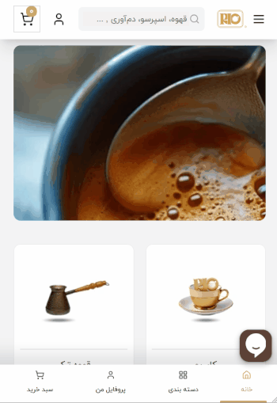

# ☕ Rio UI Project

A clone of the homepage of **[Rio](https://www.rio.coffee/)**, a coffee shop website, built with HTML and CSS using a Persian right-to-left (RTL) layout.

## 📖 Description

Rio is a front-end practice project focused on building a complete, responsive page layout from scratch. The desktop version was designed first, then adapted for tablet and mobile screens using media queries.

The project concentrates on the visual interface. Elements such as search and the shopping cart are UI mockups only and have no functionality.

> This project is built purely for practice and portfolio purposes and has no affiliation with Rio.

## ✨ Features

- Persian RTL layout
- Responsive design for desktop, tablet, and mobile
- Fixed header
- Dropdown menu on desktop
- Mobile hamburger menu built with HTML and CSS only
- Product cards with prices
- About section and branch locations
- Image gallery
- Fixed bottom navigation bar on mobile
- Custom local font (IRANYekan)

## 🛠️ Technologies

- HTML5
- CSS3
- Flexbox
- CSS Grid
- Media Queries
- `@font-face` for local fonts

> No frameworks or libraries were used.

🔗 **Live Demo:** [View live project](https://anahita-valipour.github.io/rio-website) <!-- update this link once GitHub Pages is enabled -->

---

## 📸 Preview

<!-- Replace with your actual screenshots or GIF -->

|               Mobile View                |                Desktop View                |
| :--------------------------------------: | :----------------------------------------: |
|  |  |

---

## 📁 Project Structure

```text
rio-website/
├── font/
│   └── iranyekan/
│       ├── IRANYekanWeb.eot
│       ├── IRANYekanWeb.ttf
│       ├── IRANYekanWeb.woff
│       └── IRANYekanWeb.woff2
├── imges/
├── index.html
├── style.css
├── screenshots/
│   ├── desktop.gif
│   └── mobile.gif
└── README.md
```

## 🚀 How to Run

Clone the repository and open `index.html` in your browser. No installation required.

Or open the project in VS Code and run it with the **Live Server** extension.

## 🎯 Learning Goals

This project was built to practice and strengthen:

- Structuring pages with semantic HTML
- Building layouts with Flexbox and CSS Grid
- Responsive design with a desktop-first approach
- Using media queries for tablet and mobile layouts
- Positioning elements with the `position` property
- Building menus and hover effects
- Using local fonts with `@font-face`

---

## 👩‍💻 Author

**Anahita Valipour**
🔗 [GitHub](https://github.com/anahita-valipour)

---

## 📄 License

This project was built for educational and portfolio purposes only.
